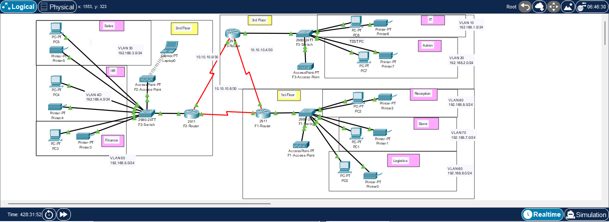

# Hotel Network: Design and Implementation

A network for a three-floor hotel with eight departments, built in Cisco Packet Tracer. Each floor has its own router and switch, every department sits in its own VLAN, and the three routers share routes with OSPF over serial links.

**Built by:** Jahslove Ukpong  
**Date:** October 2026  
**Tool:** Cisco Packet Tracer (2911 routers, 2960-24TT switches, Access Point-PT)



## Requirements

1. Three routers, one per floor, all placed in the IT server room
2. Routers connected to each other with serial DCE cables
3. Router-to-router networks: 10.10.10.0/30, 10.10.10.4/30, 10.10.10.8/30
4. One switch per floor
5. Wi-Fi on every floor for laptops and phones
6. A printer in every department
7. Every department in its own VLAN (table below)
8. OSPF as the routing protocol
9. Every device gets its address by DHCP, with each floor's router as the DHCP server
10. Every device can reach every other device
11. SSH on all routers for remote login
12. A Test-PC in the IT department to test remote login
13. Port security on the IT switch so only Test-PC can use its port (sticky MAC, violation mode shutdown)

## Addressing plan

| Floor | Department | VLAN | Network | Gateway |
| --- | --- | --- | --- | --- |
| 1 | Reception | 80 | 192.168.8.0/24 | 192.168.8.1 |
| 1 | Store | 70 | 192.168.7.0/24 | 192.168.7.1 |
| 1 | Logistics | 60 | 192.168.6.0/24 | 192.168.6.1 |
| 2 | Finance | 50 | 192.168.5.0/24 | 192.168.5.1 |
| 2 | HR | 40 | 192.168.4.0/24 | 192.168.4.1 |
| 2 | Sales/Marketing | 30 | 192.168.3.0/24 | 192.168.3.1 |
| 3 | Admin | 20 | 192.168.2.0/24 | 192.168.2.1 |
| 3 | IT | 10 | 192.168.1.0/24 | 192.168.1.1 |

| Link | Network | Usable addresses |
| --- | --- | --- |
| Router-to-router serial link | 10.10.10.0/30 | .1, .2 |
| Router-to-router serial link | 10.10.10.4/30 | .5, .6 |
| Router-to-router serial link | 10.10.10.8/30 | .9, .10 |

A /30 gives four addresses: the network, two usable hosts and the broadcast. A point-to-point link needs exactly two, so nothing is wasted.

## How it was built

### 1. Switches: VLANs, access ports and trunks

On each floor's switch, department ports were set as access ports in their VLAN, and FastEthernet0/1 (uplink to the router) was set as a trunk so all of that floor's VLANs can travel to the router tagged with 802.1Q.

```
interface range fa0/2-3
 switchport mode access
 switchport access vlan 10
interface fa0/1
 switchport mode trunk
```

### 2. Routers: router-on-a-stick

Each router has one physical link to its floor's switch, with one subinterface per VLAN. Each subinterface is the default gateway for its department.

```
interface gig0/0.80
 encapsulation dot1Q 80
 ip address 192.168.8.1 255.255.255.0
```

### 3. Serial links between routers

The routers are joined in a triangle with serial cables. On a serial link, the **DCE** end provides the clock (it sets the bit rate) and the **DTE** end synchronises to it. Without a `clock rate` on the DCE end, the line protocol stays down. I used `clock rate 64000` (64 kbps), a common lab value that matches one DS0, the basic 64 kbps channel that T1/E1 circuits are built from.

```
interface se0/2/1
 ip address 10.10.10.9 255.255.255.252
 clock rate 64000
 no shutdown
```

`show controllers serial0/2/1` shows which end of a cable is DCE.

### 4. DHCP on each router

Each router serves the departments on its floor.

```
ip dhcp pool Reception
 network 192.168.8.0 255.255.255.0
 default-router 192.168.8.1
```

### 5. OSPF

All three routers run OSPF process 10 in **area 0**, the backbone area. In a multi-area design every other area must connect to area 0, directly or (as a workaround) through a virtual link. This design is a single area, so everything is in area 0.

```
router ospf 10
 network 10.10.10.0 0.0.0.3 area 0
 network 10.10.10.4 0.0.0.3 area 0
 network 192.168.1.0 0.0.0.255 area 0
 network 192.168.2.0 0.0.0.255 area 0
```

The process ID (10) only matters on the local router; neighbours don't need to match it. The **area** must match on both ends of a link.

### 6. SSH on every router

```
hostname F3-Router
ip domain-name itil
username itil secret itill
crypto key generate rsa   (1024 bits)
line vty 0 15
 login local
 transport input ssh
```

### 7. Port security on the IT switch

```
interface fa0/2
 switchport port-security
 switchport port-security maximum 1
 switchport port-security mac-address sticky
 switchport port-security violation shutdown
```

**Deviation from the brief:** the brief puts Test-PC on fa0/1, but fa0/1 is already the trunk to the router on every switch. Test-PC is on fa0/2 instead, and port security is applied there.

### 8. Wi-Fi

An access point on each floor, secured with WPA2-PSK and AES.

## Verification

| Test | Result | What it proves |
| --- | --- | --- |
| PC7 (Admin) set to DHCP | Got 192.168.2.2, gateway 192.168.2.1 | DHCP pool and router-on-a-stick work on floor 3 |
| OSPF adjacencies on F3-Router | Two neighbours reached FULL | OSPF formed over both serial links |
| Ping from Test-PC (IT, floor 3) to 192.168.8.2 (Reception, floor 1) | 4/4 replies, TTL=126 | Routing works across floors; TTL dropped from 128 by 2, so the packet crossed two routers |
| `ssh -l <user> 10.10.10.1` from Test-PC | Logged in to F2-Router | SSH works across the network |

The first ping reply took 723 ms and the rest took 1 to 13 ms. The first packet waited for ARP to resolve the next-hop MAC address; after that the entry was cached.

## What I'd improve in version 2

- **Wildcard masks in OSPF.** I typed subnet masks (`255.255.255.252`) in the `network` commands. IOS accepted and converted them, but the command expects a wildcard (`0.0.0.3`), and that's the syntax to use.
- **`username ... secret` instead of `password`**, so the password is stored as a hash.
- **`enable secret`** on every router. Without it, an SSH user can't enter privileged mode remotely.
- **`ip ssh version 2`**, to stop SSH falling back to version 1.
- **Explicit OSPF router IDs** (`router-id 1.1.1.1`, etc.). Right now each router picked its highest interface IP, which is harder to read in `show ip ospf neighbor`.
- **Hostnames on the switches**, which still show as `Switch`.
- **DHCP exclusions** (`ip dhcp excluded-address`) for the gateway and printers, and either a real DNS server or no `dns-server` option, since no DNS server exists in this design.
- **Static or reserved addresses for printers**, so they don't move when a lease changes.

## Files

- `screenshots/` topology, configuration and test screenshots
- `configs/` running configurations of every router and switch (see the note there)
